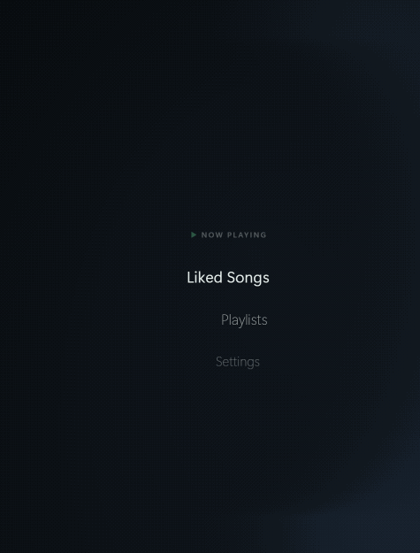

<picture>
  <source media="(prefers-color-scheme: dark)" srcset="assets/branding/turnbit-logo-white-tm.svg">
  <source media="(prefers-color-scheme: light)" srcset="assets/branding/turnbit-logo-black-tm.svg">
  
</picture>

**A floating Spotify controller for your desktop, driven by a rotary dial.**

turnbit docks a transparent, curved menu along the edge of your screen. Turn the Ulanzi D100H dial to browse playlists and songs, press to play, and keep album art and playback controls one turn away. Your music keeps playing in Spotify; turnbit is the remote.



## Features

- **Floating radial menu** that docks to the left or right screen edge, with a soft backdrop you can tune or turn off
- **Browse your library**: Liked Songs and Playlists right on Home, with **Last Song List** at the top to jump back to where you were
- **Now Playing** with album art, a seek bar, volume, like, shuffle, and repeat
- **Hardware control** with the Ulanzi D100H dial and macro buttons, even while turnbit is in the background
- **Stays out of the way**: optional transparency, idle fade, and a Gaming Mode that pauses animations
- **Targets Spotify only**: play, pause, and skip never land on a YouTube video or other app by mistake
- **Picks up where you left off**: reconnects to your preferred Spotify device when playback has gone idle
- **Custom colors** for the menu text and highlights
- **Lives in the system tray or menu bar** with play controls and an optional Start at Login, instead of a taskbar or Dock icon

## Requirements

- Windows 10 or 11 (macOS builds are not tested yet)
- [Node.js](https://nodejs.org/) 20 or newer
- Spotify Premium and the Spotify app (desktop, phone, or any Spotify Connect device)
- A free [Spotify developer app](https://developer.spotify.com/dashboard) (setup below)
- Optional: an Ulanzi D100H with [Ulanzi Studio](https://www.ulanzi.com/pages/ulanzi-app)

Without a dial, you can use the mouse and keyboard. Without Spotify connected, turnbit runs in a silent demo mode.

## Quick start

```bash
git clone https://github.com/JonathanLynnSmith/turnbit.git
cd turnbit
npm install
npm start
```

turnbit runs from the system tray or menu bar. Closing or minimizing the widget hides it there; click the turnbit icon to bring it back, and use its menu to quit.

Then [connect Spotify](#connect-spotify) and, if you have one, [set up the D100H](#set-up-the-ulanzi-d100h).

To build a standalone app, run `npm run package`. On Windows, the app is created as `turnbit.exe` in `dist\win-unpacked`; keep that whole folder together. Builds are unsigned, so Windows may show a warning the first time you run one.

## Connect Spotify

1. In the [Spotify Developer Dashboard](https://developer.spotify.com/dashboard), create an app and select **Web API**.
2. Add this redirect URI exactly: `http://127.0.0.1:43821/callback`
3. Under **User Management**, add the Spotify account you will use.
4. In turnbit, open **Settings > Playback > Spotify Connection**, paste your app's **Client ID**, and select **Connect Spotify**.
5. Approve access in your browser, then start a song in Spotify.

No client secret is needed. Your login is saved encrypted by your system's secure storage, and **Disconnect** deletes it.

> [!NOTE]
> Spotify development-mode apps are limited to a few authorized users. See [Spotify quota modes](https://developer.spotify.com/documentation/web-api/concepts/quota-modes).

## Set up the Ulanzi D100H

Install the turnbit plugin into Ulanzi Studio, then restart Studio's background process so it loads (these install scripts currently run on Windows):

```bash
npm run plugin:build
npm run plugin:install
npm run studio:restart
```

Pair the D100H in Ulanzi Studio and keep Studio running. Then assign the plugin's actions to your device:

| Control | Action |
| --- | --- |
| Dial | Navigation Wheel |
| Top left button | Previous Track |
| Top middle button | Play / Pause |
| Top right button | Next Track |
| Left side, upper button | Menu / Back |

To set this up in one step, import the profile included in the `ulanzi-plugin` folder. It also maps the remaining side buttons to volume and seek.

**Optional actions** for spare buttons: Like Current Song, Shuffle, Repeat, Pin Widget, Volume Up/Down, and Seek Back/Forward 10s.

> [!TIP]
> If Ulanzi Studio uses a custom data folder, install with `scripts\install-plugin.ps1 -PluginsDirectory "your path"`.

## Controls

### Ulanzi D100H

| Input | What it does |
| --- | --- |
| Turn the dial | Move through the menu. On Now Playing, change the volume. |
| Press the dial | Select |
| Double-press the dial | Go back one level, or straight Home with **Dial Double-Press** set to Home |
| Menu / Back | Go back. From Now Playing, go Home. |
| Play / Pause | Pause or resume. From a menu, the first press opens Now Playing. |
| Previous / Next | Tap to skip. Hold to rewind or fast-forward. |

Every list below Home starts with a **Back** row, so you can get around with the dial alone. Turn up past the first item and press, or just rest on it for a second: a small ring fills and turnbit goes back on its own. Home works the same way: **Now Playing** sits at the top of Home, so turn up and rest on it to open Now Playing. At the end of a long list, rest on **Load more** to load the next songs.

### Keyboard

These work when turnbit has focus.

| Key | What it does |
| --- | --- |
| Up / Down | Move through the menu, or change volume on Now Playing |
| Enter | Select |
| Esc or Backspace | Go back |
| Space | Open Now Playing, then pause or resume |
| Left / Right | Previous or next track |
| Shift + Left / Right | Seek 10 seconds |

If turnbit is fully transparent and you lose track of it, press **Ctrl + Alt + Shift + D** to bring it back.

## Settings

All settings are saved between restarts.

Settings are grouped into five categories. On/off settings sit inside a category; rows marked › open one more screen to pick a value.

| Category | Setting | What it does | Default |
| --- | --- | --- | --- |
| Playback | Volume | Opens a dedicated volume page |  |
| Playback | Playback Device | Moves playback to another Spotify device |  |
| Playback | Preferred Device | The device turnbit reconnects to when playback has gone idle | Automatic |
| Playback | Open Spotify Automatically | Starts the Spotify desktop app if no device is available | Off |
| Playback | Keep Song Position | Selecting the song that is already playing opens Now Playing instead of restarting it | On |
| Playback | Spotify Connection | Connect or disconnect your Spotify account |  |
| Appearance | Interface | turnbit, or the iPod and Zune extras | turnbit |
| Appearance | Screen Edge | Docks the menu on the left or right | Left |
| Appearance | Smoky Background | Strength of the dark backdrop behind the menu | 24% |
| Appearance | Text Color | Color of the menu text |  |
| Appearance | Accent Color | Color of the current song, progress, and Now Playing controls |  |
| Appearance | Case Color | Case finish (iPod and Zune interfaces) | Silver |
| Appearance | Screen Theme | Light or dark screen (iPod and Zune interfaces) | Light |
| Navigation | Reverse Dial Direction | Flips the dial's direction | Off |
| Navigation | Dial Double-Press | What a double-press of the dial does: go Back one level, or go Home | Back |
| Navigation | Back in Lists | Shows a Back row at the top of every list below Home | On |
| Navigation | Last Song List on Home | Shows Last Song List at the top of Home, above Liked Songs, to reopen the list you were browsing | On |
| Navigation | Hover Shortcuts | Resting for a second on Back, Now Playing (top of Home), or Load more (end of a long list) runs it, with a ring showing the countdown | On |
| Navigation | Click Sounds | Soft clicks while browsing | Off |
| Now Playing | Play Opens Now Playing | Pressing Play on any other screen opens Now Playing without playing or pausing. Off: Play plays or pauses and you stay on the current screen | On |
| Now Playing | Open Song in Now Playing | Choosing a song opens Now Playing | On |
| Now Playing | Idle to Now Playing | Switches to Now Playing after 10 seconds without input | On |
| Now Playing | Follow Playing Song | Recenters the playing song with a quick, smooth animation on wake after the idle fade timeout (10 seconds when idle fading is off) | On |
| Window | Transparency | Off, Always, or Idle Fade, with opacity and idle timeout | Off |
| Window | Keep on Top | Keeps turnbit above other windows | Off |
| Window | Pin Widget | Pauses idle fading and the switch to Now Playing | Off |
| Window | Dial Only Wake | While turnbit is faded out, media buttons control playback without waking it or changing screens; turn or press the dial to wake it | Off |
| Window | Mouse Click Through | Mouse input passes through the whole widget to windows behind it, even while visible. Use the D100H to navigate and turn this setting off. | Off |
| Window | Gaming Mode | Pauses decorative animations when you are not using turnbit | Off |

Next and Previous animate the current song list to the newly playing song. Idle centering uses a short, eased animation when the widget wakes.

To stay in the song list instead of switching to Now Playing, turn off **Idle to Now Playing** and **Open Song in Now Playing**.

When turnbit has faded out with Idle Fade, the first dial turn or press only wakes it. Play, Next, and Previous work right away.

## How it works

- turnbit controls Spotify through the [Spotify Web API](https://developer.spotify.com/documentation/web-api). Audio always plays in Spotify itself.
- On Windows, when the Spotify desktop app is playing on the same PC, play, pause, skip, and seek go straight to Spotify's own media session. They work instantly, use no API calls, and never affect other apps.
- If you start a song after Spotify has gone idle, turnbit reconnects to your Preferred Device (opening Spotify first, if you allow it) and tries the song again.
- turnbit checks Spotify less often when music is paused or the window is hidden, which helps it stay within Spotify's rate limits.
- If Spotify rate-limits a feature, only that feature pauses, and turnbit shows when it will be available again.

## Troubleshooting

| Problem | Try this |
| --- | --- |
| "No Spotify device is available" | Start a song in Spotify, choose a Preferred Device, or turn on Open Spotify Automatically. A phone or speaker must be on and online; turnbit cannot wake it. |
| "Retry loading" on Liked Songs | Spotify may be rate-limiting your library. The message shows when it will clear. |
| A playlist's songs will not load | Spotify only lets apps list songs in playlists you own or collaborate on. **Play this playlist** still works. |
| The D100H does nothing | Make sure Ulanzi Studio is running and the device is paired, then run `npm run studio:restart`. |
| Like asks for permission | Reconnect in **Settings > Playback > Spotify Connection** to grant the newer library permissions. |

To see every Spotify API call and any rate-limit wait, start turnbit with logging on:

```powershell
# Windows (PowerShell)
$env:TURNBIT_DEBUG_API=1; npm start
```

```bash
# macOS / Linux
TURNBIT_DEBUG_API=1 npm start
```

## Development

| Command | What it does |
| --- | --- |
| `npm start` | Run turnbit |
| `npm run check` | Syntax checks and unit tests |
| `npm run smoke` | Drive the real app in demo mode with simulated dial input |
| `npm run package` | Build the standalone app |
| `npm run plugin:build` | Build the Ulanzi plugin |
| `npm run plugin:install` | Install the plugin into Ulanzi Studio |
| `npm run studio:restart` | Restart Ulanzi Studio's background process |
| `npm run demo:gif` | Rebuild the README demo GIF (`assets/demo/turnbit-demo.gif`) from a scripted demo-mode run |

The smoke test uses its own session and port, so it can run while turnbit is open. Tests simulate Spotify and the dial; they do not use a real account or device.

<details>
<summary>Local device bridge</summary>

The Ulanzi plugin talks to turnbit through a small HTTP bridge on `127.0.0.1:4765`.

- `GET /device/state` returns the plugin status, last event, and event count.
- `POST /device/event` accepts JSON such as `{"type":"command","command":"next"}` or `{"type":"dial","delta":1,"held":false}`.

The bridge listens only on your own machine, validates every request, and rejects ordinary websites. It never exposes your Spotify login. turnbit also needs port `43821` free for the Spotify login callback.

</details>

<details>
<summary>Spotify permissions</summary>

turnbit requests these scopes: `user-read-playback-state`, `user-modify-playback-state`, `user-read-currently-playing`, `playlist-read-private`, `playlist-read-collaborative`, `user-library-read`, and `user-library-modify`.

Login uses Authorization Code with PKCE and a state-checked local callback. You can revoke access at any time from the Apps page of your Spotify account.

</details>

## Resources

- [Spotify Web API](https://developer.spotify.com/documentation/web-api)
- [Spotify PKCE authorization](https://developer.spotify.com/documentation/web-api/tutorials/code-pkce-flow)
- [Ulanzi plugin SDK](https://github.com/UlanziTechnology/UlanziDeckPlugin-SDK)
- [Ulanzi Studio](https://www.ulanzi.com/pages/ulanzi-app)

## License

The turnbit software is released under the [MIT License](LICENSE).

**turnbit™** is a trademark. The MIT License does not grant rights to the turnbit name or logo. The bundled Ulanzi SDK keeps its Apache 2.0 license (`libs/LICENSE` and `libs/NOTICE.md` in the plugin folder), and other third-party components keep their own licenses.

